<p align="center">
  
</p>

# promptosaur-motion

One instruction file for AI agents that make videos with code, plus six small tools that check their work. The model reads the file before it starts. It covers motion graphics openers, explainers on a voice-over, 3D cartoons and 3D action scenes.

It comes from the Promptosaur test **Claude Fable 5.2 vs Gemini 4 Hydrogen**: [watch the video](https://youtu.be/Bw7ly7Dsntc). Both models got the same five jobs. Every sentence that fixed a broken result went into this file.

## Quick start

1. Download [`promptosaur-motion.md`](promptosaur-motion.md) and put it into your project folder. Copy the [`tools/`](tools) folder next to it if you want the checks (optional).
2. Start your prompt with:

   ```
   Read promptosaur-motion.md in this folder first and follow it.
   ```

3. Every time something breaks and one sentence fixes it, add that sentence to section 8.

That works with any agent that can read files: Claude Code, Gemini in Antigravity or Gemini CLI, Codex, Cursor.

**Claude Code as a skill.** Copy the skill folder and the tools into `~/.claude/skills/` (all projects) or `.claude/skills/` of one project. Claude then loads it by itself whenever you ask for a video made with code.

```
git clone https://github.com/maskaads/promptosaur-motion
cp -r promptosaur-motion/skills/promptosaur-motion ~/.claude/skills/
cp -r promptosaur-motion/tools ~/.claude/skills/promptosaur-motion/
cd ~/.claude/skills/promptosaur-motion/tools && npm install && pip install -r requirements.txt
```

## What is inside the file

| Section | What it does |
|---|---|
| 1. Order of work | `plan.md`, a `timeline.json` that drives every move, a full rough draft, contact sheets of 8 frames per shot, a fix list, a timed test frame, then the final render |
| 2. Motion rules | ease-out on every move, 2 to 4 frames between starts, 12-frame holds, 1 s per 3 words of text, a change every 1.5 to 2.5 s; sound at -14 LUFS with the voice on top |
| 3. Motion graphics opener | beats, one main object per scene, scenes linked by shape, morphs in one piece, a still final card |
| 4. Explainer on a voice-over | forced alignment to the script, `frame = round(start * fps)`, every number on screen on its word |
| 5. 3D cartoon | the character in numbers, IK-pinned feet, a camera that checks itself against every solid, face brightness and highlight limits |
| 6. 3D action scene | wheels turned by distance, springs per axle, contact dust, seeded camera shake, logged gaps between bodies, cheap shadows |
| 7. Self-check | nine questions the model answers on its own frames, each tied to a tool that measures it |
| 8. Fix sentences | seven sentences from the video, one from the skill test below, plus the ones you add |

## The tools

Each one is a single file. Node 18+, Python 3.9+, ffmpeg on PATH.

| Tool | What it does | Tested on |
|---|---|---|
| [`capture.mjs`](tools/capture.mjs) | films an HTML or SVG page frame by frame in headless Chrome. Time comes from the frame number (`window.renderFrame(frame, fps)`, CSS animations, `requestAnimationFrame`, `Date.now` all follow it), so two runs give the same video. Turns the GPU on, prints which GPU it got and warns when Chrome fell back to the processor. Skips frames that exist, so a crashed run resumes. `--encode final.mp4 --audio mix.wav` makes the file | the example opener (210 frames, 0.2 s a frame on an RTX 3060) and the animated SVG at the top of this page |
| [`align.py`](tools/align.py) | word starts of a voice-over from its known text by forced alignment (wav2vec2 + Viterbi). Reads numbers the way they are spoken, prints the frame of every number | two synthetic voices with known word times: 38 of 55 and 24 of 27 words within 1 frame, 79 of 82 within 2. A Whisper transcript of the same audio: 13 of 55 within 1 frame, up to 20 frames off |
| [`check_timeline.py`](tools/check_timeline.py) | reads `timeline.json` and reports same-frame starts, linear moves, missing holds, text too short to read, long stretches with nothing new, events off their word, spoken numbers with nothing on screen | caught a number placed 3 frames late and a number with no event |
| [`check_layout.mjs`](tools/check_layout.mjs) | renders the page and measures every element marked `data-text` or `data-solid` on every second frame: text inside the 100 px edge margin, text over text, text over a shape that is not its own panel | found a label under a shape (frames 98 to 100) and a tagline over the title, both planted on purpose |
| [`review.py`](tools/review.py) | `sheet`: 8 labelled frames per shot in one image. `frames`: empty, dark, burned and frozen frames. `final`: decodes the whole file, checks length, size, fps, pixel format, sound, loudness and true peak | its contact sheets found a shape poking through the prompt bar in the example opener |
| [`watchdog.py`](tools/watchdog.py) | runs a render, kills it when no new frame appears for `--stall` seconds, starts it again | a render that hung after 3 of 6 frames was restarted and finished |

[`examples/opener/`](examples/opener) is a 7-second opener built the way the file asks: `timeline.json` holds every move, `index.html` reads it in `renderFrame`. Film it with:

```
node tools/capture.mjs examples/opener/index.html --duration 7 --out frames --encode opener.mp4
python tools/check_timeline.py examples/opener/timeline.json
python tools/review.py sheet opener.mp4 --timeline examples/opener/timeline.json
node tools/check_layout.mjs examples/opener/index.html --duration 7
```

## Skill test

A fresh agent got only this file, the tools and one line: *"Read promptosaur-motion.md in this folder first and follow it. Then make a 10-second motion graphics opener for a YouTube channel called Promptosaur."* This is what came out:

<p align="center"></p>

It took about 25 minutes. The finished file measured 10.00 s, 1920x1080, 30 fps, -14.3 LUFS, true peak -2.4 dBFS; `review.py frames` found 0 problems in 300 frames. On its way the agent caught an empty frame 0, a morph that jumped between frames 82 and 83 (an ease that returned -4e-16 instead of 0), a tagline over the title, flickering text and a true peak of -0.4 dBFS after AAC encoding. Its log also found problems in the tools themselves: the true peak was never measured, child processes opened console windows on Windows, Chrome's text smoothing changed between frames, and layout had no checker. All of that is fixed in this version, and the two lessons went into the file as fix sentence 8.

## The seven fixed sentences

| # | Sentence | What broke without it |
|---|---|---|
| 1 | Every visual change starts on the first frame of its word. | Round 3: a number faded in a few frames before the voice said it |
| 2 | Feet stay planted on every step, including the last one. | Round 4: the last step snapped the foot to its final spot |
| 3 | Align the words to the text, then check the frame of every number before you render. | Round 3: the first transcript had word starts off by several frames |
| 4 | When shapes turn into a character, morph them in one piece. | Round 2: one picture was swapped for another and the shapes jumped |
| 5 | Light the face so it reads in every shot, and keep a screen in a dark scene below pure white. | Round 4: the face got lost in the dark and the laptop screen burned to white |
| 6 | Render on the graphics card and pick shadows that are cheap to draw. | Rounds 3 and 4: frames drawn on the processor, a slow shadow effect, half the time spent rendering |
| 7 | If the render writes no new frame for two minutes, stop it. | Round 1: the render froze and left an empty `final.mp4` |

## The test in numbers

Costs are at API prices. The runs were on subscriptions, where the same tokens eat the plan's limit.

| Round | Job | Claude Fable 5.2 | Gemini 4 Hydrogen | Winner |
|---|---|---|---|---|
| 1 | 15 s opener, one-line prompt | about $9, 17 min | under $1.50, 7 min | Fable |
| 2 | 15 s opener with a brief | about $10.50, 23 min | about $1.25, 6 min | Fable, by a little |
| 3 | 20 s explainer on a voice-over | about $19, 51 min | about $2, 54 min | Fable |
| 4 | 20 s 3D cartoon | about $18, 35 min | about $5, 27 min | Fable |
| 5 | 20 s 3D chase | about $23, 43 min | about $2.25, 16 min | Fable |
| | **All five** | **about $79, almost 3 h** | **about $12, under 2 h** | |

Then Hydrogen got this file and the one-line cartoon prompt with no brief. The feet stayed planted and the jungle lit up on the key press. It rendered on the graphics card and finished in 14.5 minutes for about $3, against 27 minutes and $5 with the full brief in round 4.

## The prompts

All prompts from the video are in [`prompts/`](prompts):

| File | Round |
|---|---|
| [`1-opener-one-line.txt`](prompts/1-opener-one-line.txt) | 1, the lazy prompt |
| [`2-opener-with-brief.txt`](prompts/2-opener-with-brief.txt) | 2, the same opener with a full brief |
| [`3-voiceover-explainer.txt`](prompts/3-voiceover-explainer.txt) | 3, the creative-director prompt; the voice-over text is in [`3-voice.txt`](prompts/3-voice.txt) |
| [`4-3d-cartoon.txt`](prompts/4-3d-cartoon.txt) | 4, the 3D cartoon with the character in numbers |
| [`5-3d-chase.txt`](prompts/5-3d-chase.txt) | 5, the chase with physics written as rules |
| [`6-skill-test.txt`](prompts/6-skill-test.txt) | the skill test: this file plus one sentence |
| [`after-each-run-log.txt`](prompts/after-each-run-log.txt) | sent after every run to get the model's own log of tools and fixes |

The header animation at the top of this page is one SVG file written by hand, no video and no image generator: [`assets/hero.svg`](assets/hero.svg).

## License

MIT. Use it, change it, ship it in your own projects.
